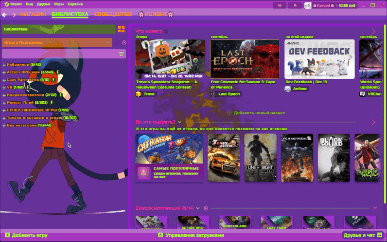

# Neon In The Woods

A custom Steam theme featuring an embedded **WebGL fluid simulation** for a dynamic, modern background experience. 

---

## ⚠️ CRITICAL REQUIREMENT / ВАЖНОЕ ТРЕБОВАНИЕ

> **EN:** **GPU Acceleration must be enabled in Steam settings!**  
> Without hardware acceleration, the WebGL background will cause heavy CPU overhead (up to 90% load). The code itself is highly optimized with zero memory leaks, but it relies entirely on your GPU to run smoothly.
>
> *How to enable:* `Settings` ➔ `Interface` ➔ Toggle on `Enable hardware text rendering in web views`.

> **RU:** **В настройках Steam обязательно должно быть включено аппаратное ускорение!**  
> Без него WebGL-анимация на фоне перегрузит ваш процессор (нагрузка до 90%). Сам код отлично оптимизирован и не имеет утечек памяти, но для плавной работы ему жизненно необходима видеокарта.
>
> *Как включить:* `Настройки` ➔ `Интерфейс` ➔ Включите `Рендеринг веб-страниц с помощью видеокарты`.

---

## 🛠 Current Status & Known Issues (WIP)

Please note that this theme is a **Work in Progress (WIP)**, developed solely in my spare time. Updates might arrive slowly, and you may encounter minor visual bugs or placeholder elements.

*   **Visual Polish:** Some UI components currently use temporary placeholders that might conflict slightly with the main Steam aesthetic. 
*   **Performance:** Perfectly stable and safe when GPU acceleration is active.
*   **Updates:** Bug fixes and new features will be pushed directly to this repository and updated automatically via Millennium.

---

## 🎨 Features
*   **Advanced WebGL Background:** Smooth, fully optimized fluid simulation.
*   **Zero Memory Leaks:** Clean performance-focused architecture.
*   **Millennium Compatible:** Seamless integration and automatic background updates.

---

## 🤝 Feedback & Support
If you encounter any breaking bugs or have suggestions, feel free to open an **Issue** here on GitHub or reach out in our Discord community. Thank you for your support and patience!
